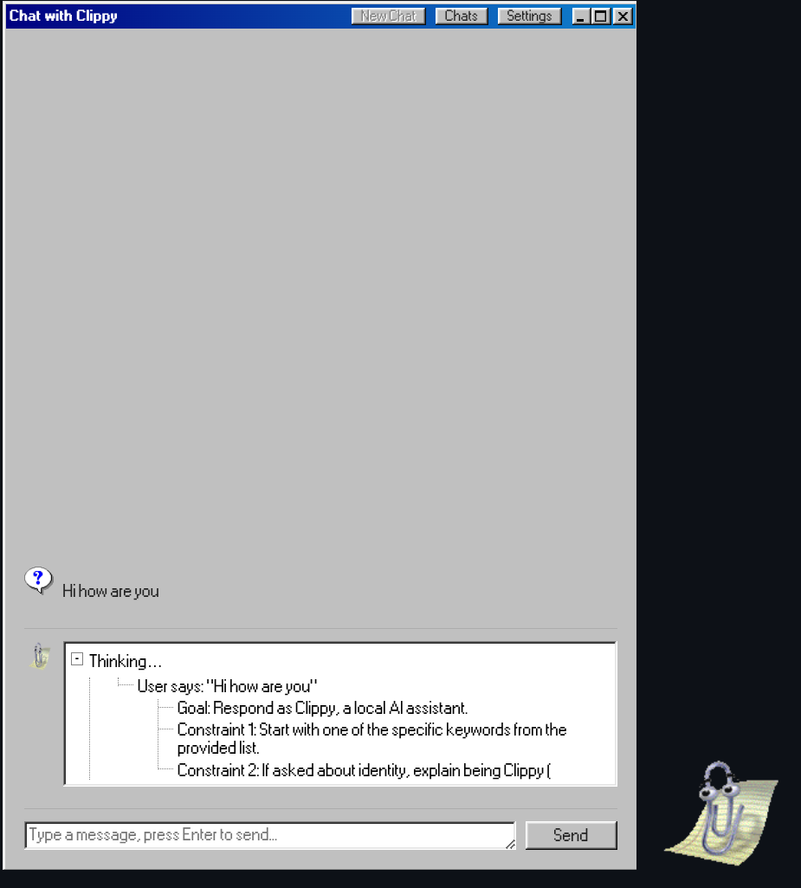

# Clippy

> **Downstream edition:** This is a fun, mostly AI-driven weekend project and a
> Linux- and NixOS-focused fork maintained by
> [@phantomeniasll](https://github.com/phantomeniasll). The original project is
> [felixrieseberg/clippy](https://github.com/felixrieseberg/clippy). Upstream
> authorship and licensing are preserved.



[Clippy](https://felixrieseberg.github.io/clippy/) let's you run a variety of large language models (LLMs) locally on your computer while sticking with a user interface of the 1990s. Through Llama.cpp, it supports models in the popular GGUF format, which is to say most publicly available models. It comes with one-click installation support for Google's Gemma3, Meta's Llama 3.2, Microsoft's Phi-4, and Qwen's Qwen3.

It's a love letter and homage to the late, great Clippy, the assistant from Microsoft Office 1997. The character was designed by illustrator Kevan Atteberry, who created more than 15 potential characters for Microsoft's Office Assistants. This app is not affiliated, approved, or supported by Microsoft. Consider it software art. If you don't like it, consider it software satire.

It is also meant to be a reference implementation of [@electron/llm](https://github.com/electron/llm), hoping to help other developers of Electron apps make use of local language models.

## Changes in This Fork

- A current external `llama-server` backend for models that use multi-token
  prediction (MTP), while retaining the original `@electron/llm` backend for
  other GGUF models.
- One-click Unsloth presets for Gemma 4 26B-A4B and Qwen3.6 35B-A3B, including
  a smaller IQ2 quantization of Qwen3.6.
- Streaming answers, collapsible reasoning output, generated/thinking token
  counts, and measured token throughput.
- A Windows 95-style **New Chat** action and an answer-ready badge on Clippy.
- Linux helper-window behavior: no regular taskbar entry and optional
  always-on-top Clippy/chat windows.

MTP models need a recent `llama-server` exposed through the
`CLIPPY_LLAMA_SERVER` environment variable. The companion
[clippy-nix](https://github.com/phantomeniasll/clippy-nix) package supplies a
Vulkan-enabled server and the Electron runtime automatically. The fork is
currently tested and packaged on x86_64 Linux; the inherited upstream build
workflow still covers the other desktop targets.

## Features

- Simple, familiar, and classic chat interface. Send messages to your models, get a response.
- Batteries included: No complicated setup. Just open the app and chat away. Thanks to llama.cpp and `node-llama-cpp`, the app will automatically discover the most efficient way to run your models (Metal, CUDA, Vulkan, etc).
- Custom models, prompts, and parameters: Load your own downloaded models and play with the settings.
- Offline, local, free: Everything runs on your computers. The only network request Clippy makes is to check for updates (which you can disable).

## Non-Features

Countless little chat apps for local LLMs exist out there. Many of them are likely better - and that's okay. This project isn't trying to be your best chat bot. I'd like you to enjoy a weird mix of nostalgia for 1990s technology paired with one the most magical technologies we can run on our computers in 2025.

## Downloading More Models

Clippy supports (thanks to Llama.cpp) most GGUF models. You can find GGUF models in plenty of online sources - I tend to go with models quantized by [TheBloke](https://huggingface.co/thebloke) or [Unsloth](https://huggingface.co/unsloth).

## Development

The normal upstream development commands still apply:

```sh
npm ci
npm start
```

For the MTP path, set `CLIPPY_LLAMA_SERVER` to a compatible `llama-server`
binary before starting the app. NixOS development is reproducible through the
companion package:

```sh
nix build github:phantomeniasll/clippy-nix \
  --override-input clippy-src path:$PWD
```

Please report fork-specific issues in this fork. Changes that are useful
without the Linux/Nix integration should remain suitable for sending upstream
as focused pull requests.

## Acknowledgements

Thanks to:

- I am so grateful to Microsoft - not only for everything they've done for Electron, but also for giving us one of the most iconic characters and designs of computing history.
- [Kevan Atteberry](https://www.kevanatteberry.com/) for Clippy
- [Jordan Scales (@jdan)](https://github.com/jdan) for the Windows 98 design
- [Pooya Parsa (@pi0)](https://github.com/pi0) for being the (as far as I know) person to extract the length of each frame from the Clippy spritesheet.
- [node-llama-cpp](https://github.com/withcatai/node-llama-cpp) for squeezing llama.cpp into Node.js
